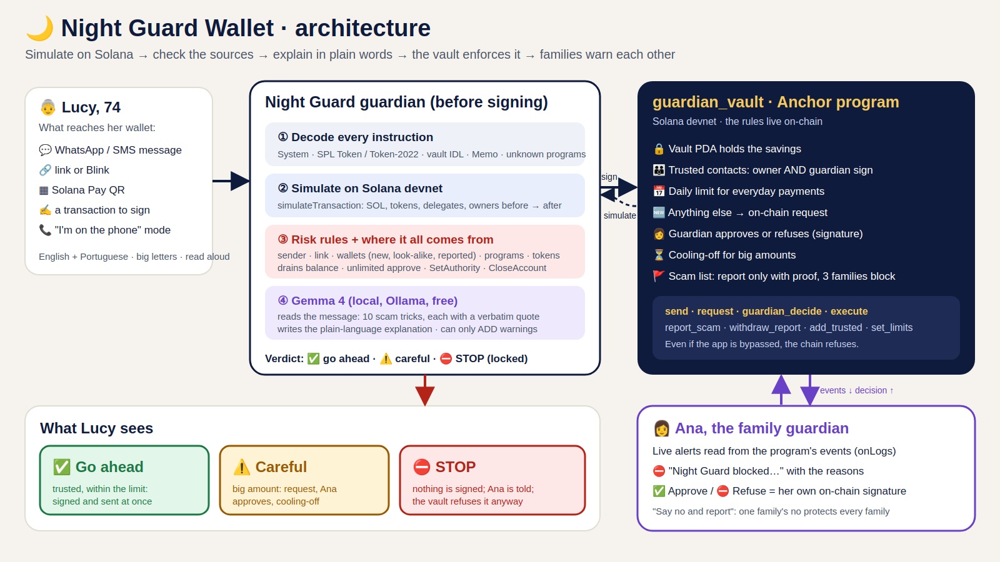

# 🌙 Night Guard Wallet

**A guard for the people scammers target the most: our parents and grandparents.** Before Lucy (74) signs anything, Night Guard Wallet **simulates the transaction on Solana**, shows in big plain words what would really change, **flags the scam** (with Gemma reading the message that came with it), and keeps her savings in an **on-chain vault** whose rules nobody can switch off: trusted contacts, a daily limit, a family guardian who approves with her own signature, and a cooling-off period for big amounts.

MLH Solana Hackathon · AI Track ("security tools that explain what a transaction will do or flag risky programs, tokens and wallets before a user signs").

| **5/5** | **2/2** | **0.2 s** | **32/32 · 0** | **5** |
|:-:|:-:|:-:|:-:|:-:|
| scam scenarios stopped, in PT and EN, on every run | real family payments let through | from "check" to verdict on screen (median, devnet simulation included) | scam messages Gemma recognised · false alarms on 28 ordinary family messages | scams refused **by the program itself** on devnet, even when forced past the app |

<sub>[docs/RESULTS.md](docs/RESULTS.md): 42 checks on Solana devnet (7 scenarios × 2 languages × 3 runs) and the on-chain proofs with explorer links. [docs/EVAL.md](docs/EVAL.md): 60 fictional messages, Gemma 4 E2B on a CPU. Every person and message in this repository is fictional.</sub>

## Why

People over 60 reported **$7.7 billion** lost to fraud in 2025, **$4.3 billion** of it involving crypto, an average of **$38,500** per victim ([FBI IC3 2025 Internet Crime Report](https://www.ic3.gov/AnnualReport/Reports/2025_IC3Report.pdf), Elder Fraud section). On a blockchain there is no bank to call: one signature can't be undone. The scams are always the same few stories: the "son" with a new number, the fake bank or wallet support, the free airdrop, the prize with a fee to unlock, the address copied from history.

## What it does



1. **Simulate on Solana.** The wallet runs the transaction with `simulateTransaction` on devnet and compares every writable account before and after: SOL, tokens, **delegates (approvals)** and **owners (authorities)**. Instructions are decoded too: System, SPL Token and Token-2022, the vault's own IDL, Memo, and any unknown program.
2. **Flag the risk** with rules on the simulated result: a wallet she never paid (and how new it is), an address that **looks like** a trusted contact's (address poisoning), most of her money leaving, an **unlimited `approve`**, **`SetAuthority`** or **`CloseAccount`** to a stranger (drainers), a **fake token** that calls itself USDC (Token-2022 metadata vs. the verified mint), a **phishing link or Blink** that imitates a Solana brand, a **Solana Pay QR**, and the vault refusing it.
3. **Read the message with AI.** Gemma 4 (E2B, via Ollama, free, on our own machine) reads the WhatsApp or SMS that came with the request and lists the scam tricks (new number, rush, secrecy, fake support, "safe wallet", prize, fee to unlock, secret words, emergency, guaranteed profit), **each with a verbatim quote** that must exist in the message. Then it writes the explanation in plain Portuguese or English, which she can hear out loud.
4. **Lock and ask the family.** If the verdict is STOP, nothing is signed. One tap opens an **on-chain request**; Ana, her daughter and guardian, sees it live (read from the program's events) and approves or refuses **with her own signature**.

The verdict never depends on the model: the simulation and the rules decide, and the model can only **add** warnings. If Gemma is slow or off, fixed texts are used. Any amount the model writes must be the real one.

### What Solana does here (not a chain bolted onto a web2 app)

The `guardian_vault` Anchor program ([programs/guardian_vault/src/lib.rs](programs/guardian_vault/src/lib.rs)) holds the savings in a PDA and enforces the rules on-chain:

| Rule | On-chain |
|---|---|
| Money only goes out at once to **trusted contacts**, under the **daily limit** and below the "large amount" | `send` refuses with `NotTrusted`, `OverDailyLimit` or `NeedsCoolingOff` |
| **Adding a trusted contact needs two signatures**: the owner AND the guardian. A scammer who talks Lucy into signing still can't add their wallet | `add_trusted` (`has_one = guardian`) |
| Anything else is a **request**; the program itself decides if the guardian must approve (new wallet or over the limit) and how long it waits (big amount) | `request` → `guardian_decide` → `execute` |
| A refused request can never be sent; a big one can't leave before the **cooling-off** ends | `Rejected`, `StillCoolingOff` |
| Every step emits an **event**; the family page listens to the program's logs, so the alert comes from the chain | `RequestOpened`, `GuardianDecided`, `Executed`… |

Proven on devnet: transfers to the scammer and to the look-alike address, **forced through without preflight**, failed on-chain with `NotTrusted`; a fake "guardian" could not add the scammer; a rejected request could not be sent; a big payment could not leave before its cooling-off ([links](docs/RESULTS.md#on-chain-proofs-devnet)).

| | Devnet address |
|---|---|
| Program `guardian_vault` | [`8vE76ymUvgkQdwBmtQ68kVuaxPvUVN7YymSpSkf3hwtn`](https://explorer.solana.com/address/8vE76ymUvgkQdwBmtQ68kVuaxPvUVN7YymSpSkf3hwtn?cluster=devnet) |
| Lucy's vault (PDA) | [`61fPy5MYaTmuwytGHQcvX6QLqqeCNsKHcByyoG3TRWwh`](https://explorer.solana.com/address/61fPy5MYaTmuwytGHQcvX6QLqqeCNsKHcByyoG3TRWwh?cluster=devnet) |
| The fake "USDC" airdropped to Lucy (Token-2022) | [`BsUTsjGgXJnNisSLDBAkbCCS6YQETwBkGqWyURjdcQvq`](https://explorer.solana.com/address/BsUTsjGgXJnNisSLDBAkbCCS6YQETwBkGqWyURjdcQvq?cluster=devnet) |

## The seven situations in the demo

| Situation | Arrives as | What the guardian sees | Verdict |
|---|---|---|---|
| Ana asks for the grocery money | WhatsApp, saved number | trusted contact, within the limit | ✅ sent at once by the vault |
| The "son" with a new number: 1.8 SOL, urgent, "don't tell dad" | WhatsApp, unknown number | vault refuses (`NotTrusted`), brand-new wallet, 68% of her money, Gemma quotes *new number · rush · secret* | ⛔ |
| Fake wallet support: "authorize the migration to the safe wallet" | SMS + `phantom-seguranca.com` | `SetAuthority` hands her token account to a stranger, phishing link | ⛔ |
| "You won 500 free USDC", claim now | Blink link `so1ana-airdrop.com` | **unlimited `approve`** to a stranger, phishing link, fake USDC | ⛔ |
| Paying "Ana" with an address copied from history | Solana Pay QR | address **looks like** Ana's (`4QaK…qHpN` × `4QaK…TexR`), vault refuses | ⛔ |
| "You got 1,000 USDC, pay the 0.4 SOL fee to unlock" | in-app message | the USDC in her wallet is **fake** (Token-2022 metadata, not the verified mint), new wallet, fee-to-unlock trick | ⛔ |
| Pedro: 1 SOL for the car repair, no rush | call, saved number | trusted, but a big amount: request → Ana approves → **60 s cooling-off on-chain** (24 h in real life) → sent | ⚠️ then ✅ |

Plus a **phone-scam mode** ("I'm on the phone with someone"): any payment to a wallet outside the trusted list is stopped, with a reminder that banks and support never ask for transfers by phone.

## Run it

Needs Node 20+, Docker (for the Anchor and Playwright images), and Ollama for the AI part. All free.

```bash
git clone https://github.com/jenniferevangelista-de/night-guard-wallet
cd night-guard-wallet

# 1. Build and deploy the program (official Anchor image; keys stay in ~/.config/ngw, outside the repo)
cloud/anchor.sh "solana-keygen new --no-bip39-passphrase -o /keys/deployer.json"   # fund it at faucet.solana.com
cloud/anchor.sh "anchor build && anchor deploy --provider.cluster devnet --provider.wallet /keys/deployer.json"

# 2. Gemma on your own machine
ollama pull gemma4:e2b

# 3. The demo family on devnet: vault, trusted contacts, demo dollar, fake USDC, look-alike wallet
cd app && npm install
npm run setup

# 4. The wallet (Lucy) and the guardian page (Ana)
npm start          # http://localhost:8787  and  http://localhost:8787/family.html
```

| Command | What it does |
|---|---|
| `npm test` | offline tests: phishing links, look-alike addresses, scam tricks, drainer and vault instruction decoding, Solana Pay |
| `npm run demo` | the measured run: every scenario through the guardian, timed, then the on-chain proofs → `docs/RESULTS.md` |
| `npm run eval` | the 60-message evaluation → `app/out/eval_*.json` ([docs/EVAL.md](docs/EVAL.md)) |
| `NGW_AI=template npm start` | no model: fixed texts only |

Settings: `NGW_RPC` (default devnet), `NGW_MODEL` (default `gemma4:e2b`), `OLLAMA_URL`, `NGW_COOLING_OFF` (seconds, default 60 for the demo). The demo signs with devnet keypairs kept in `~/.config/ngw/demo`; a real wallet would sign in the user's wallet app instead.

## How it was built

| | |
|---|---|
| On-chain | Rust, Anchor 0.31.1, Solana devnet (built in the official `solanafoundation/anchor` image) |
| Guardian | TypeScript, `@solana/web3.js`, `@coral-xyz/anchor`, `@solana/spl-token` (+ Token-2022 metadata) |
| AI | Gemma 4 E2B via Ollama, structured JSON output, evidence check on every quote, on a 4-core CPU with no GPU |
| Screens | plain HTML, big letters, PT/EN, read aloud with the browser's speech synthesis |
| Video | Pillow + ffmpeg, Playwright recording of the real app, edge-tts (Ava) |

### What existed before, and what was built during the hackathon

| Pre-existing (from [Night Guard](https://github.com/jenniferevangelista-de/night-guard), the author's child-safety project) | Built during the hackathon (06–08/11/2026) |
|---|---|
| The idea and the pattern: a local Gemma model flags risk, safety-critical decisions never come from the model alone, the family stays in the loop | Everything Solana: the `guardian_vault` program, the simulation and decoding, the risk rules, the vault client, the setup and the on-chain proofs |
| The Ollama call pattern (structured JSON, evidence that must appear in the text) | The scam-trick reader for payment messages, the explanation writer and its checks, the 60-message evaluation |
| `video/ng/palito.py` and `ng_film_helpers.py` (paper and ink drawing), the tour frame and mix of the Night Guard videos | Lucy's wallet and Ana's guardian page, Olive the owl, the video, this README and the architecture drawing |

## Limits

- Devnet only, and the demo signs with demo keypairs on a server. A real product would run the guardian inside the wallet app (or as a wallet-standard extension) and keep keys on the user's device.
- The message evaluation is a small fictional set written by the author: it shows the approach, not field accuracy.
- Gemma on a CPU takes a few seconds; the verdict does not wait for it, only the explanation does.
- The look-alike and phishing checks use built-in lists; a production version would add a maintained registry of verified tokens and domains.

## Credits

Music in the video: "Funkorama" by Kevin MacLeod (incompetech.com), licensed under Creative Commons: By Attribution 4.0 (https://creativecommons.org/licenses/by/4.0/).

MIT License.
