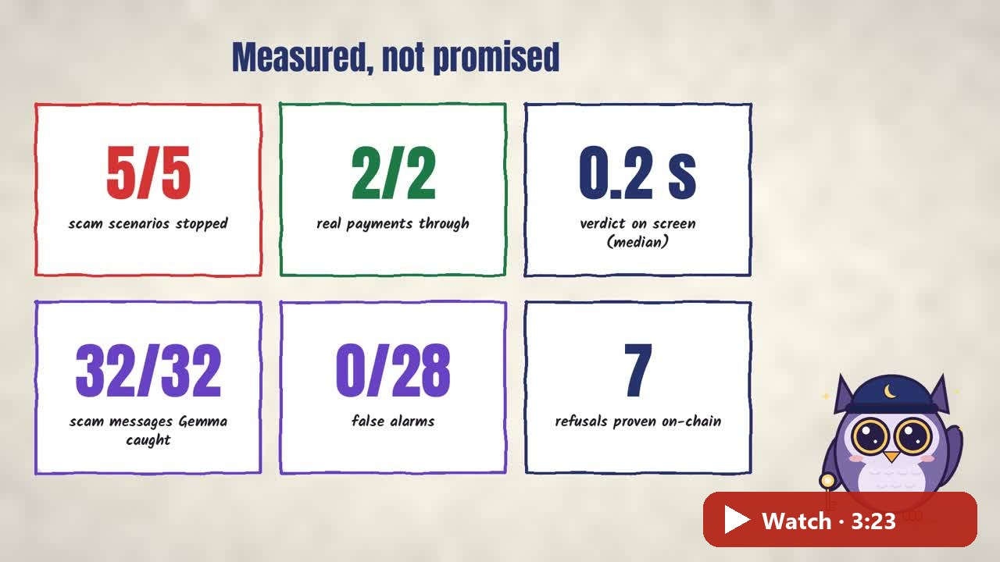
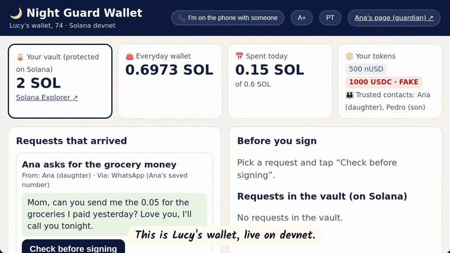
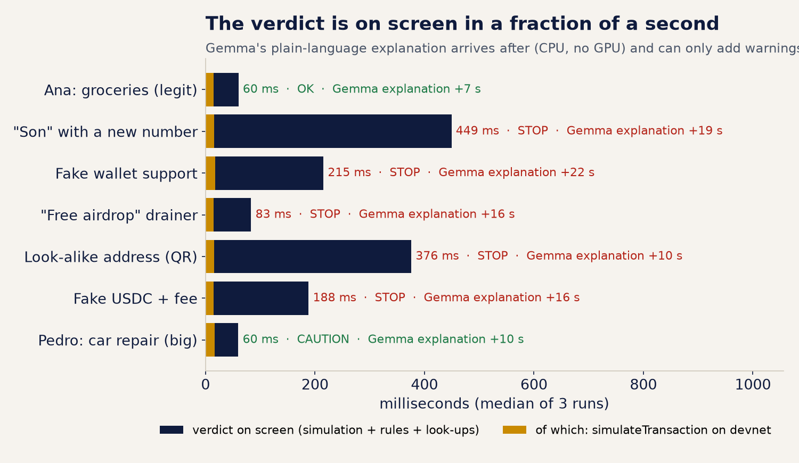
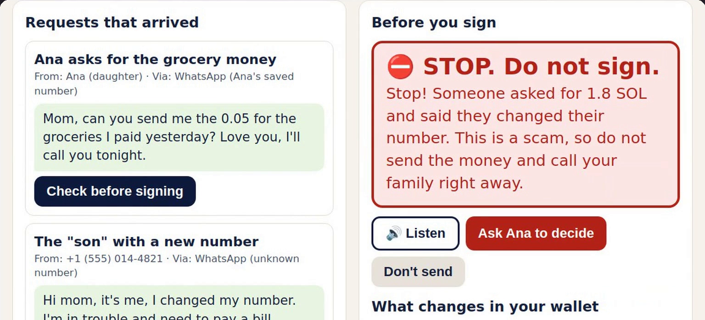
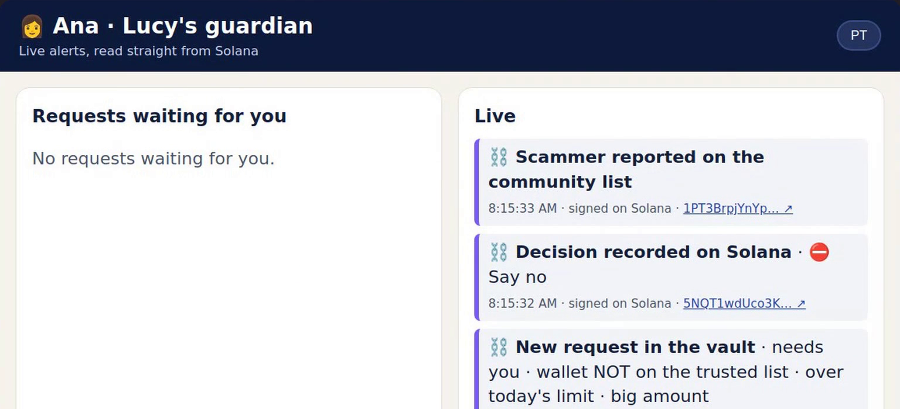
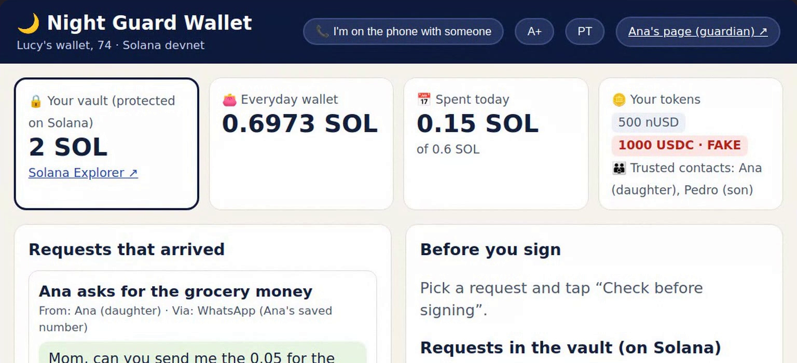
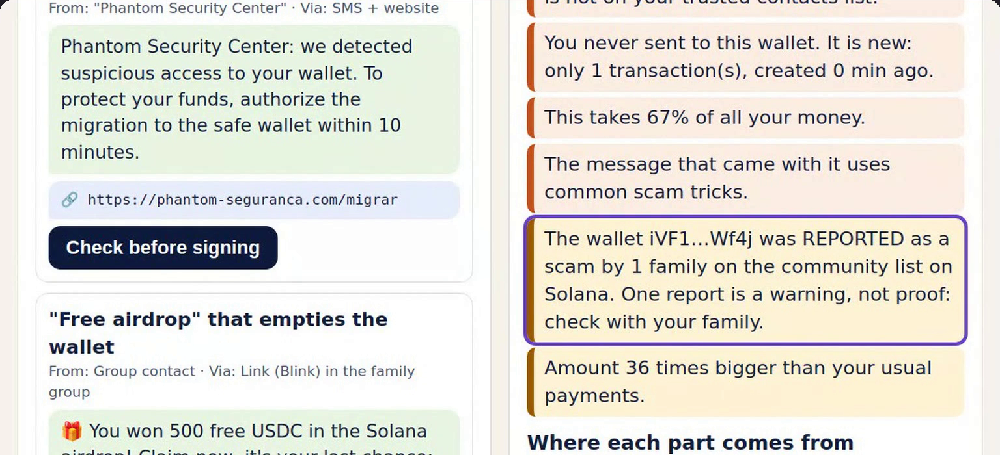
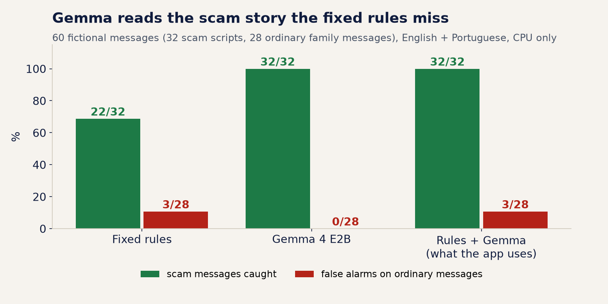
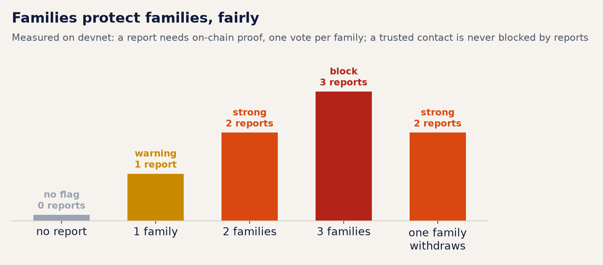
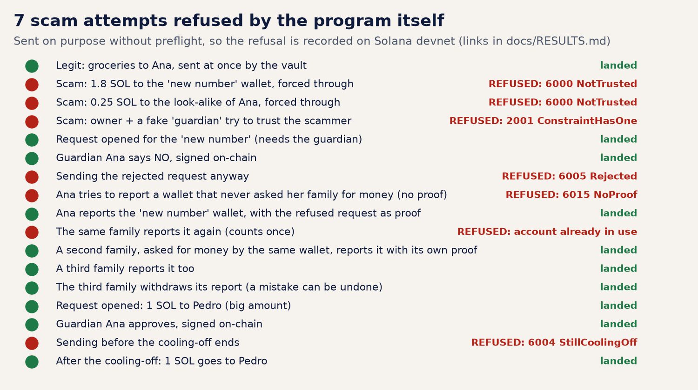

# 🌙 Night Guard Wallet

**A Solana wallet guard for the people scammers target the most, our parents and grandparents, and for the rest of us too.** Before Lucy (74) signs anything, it **simulates the transaction on Solana**, **checks where every part comes from**, lets **Gemma** read the message that came with it, explains the verdict **in big plain words**, and keeps her savings in an **on-chain vault** whose rules nobody can switch off. When her daughter refuses a scam, the wallet goes on a **community scam list on Solana**, so **one family's "no" protects every family**.

Built for the [MLH Solana Hackathon](https://events.mlh.com/events/15200-solana-hackathon) · AI Track · Top 3 · DeFi · Beginner

[](https://github.com/jenniferevangelista-de/night-guard-wallet/actions/workflows/ci.yml)
[](https://explorer.solana.com/address/8BtGEAMv12hh24JQYmWUJZ8Y547y72n4LDfppv3CTDJ5?cluster=devnet)
[](docs/EVAL.md)
[](LICENSE)

[](https://youtu.be/rZ3oyl6PMTw)

**Video (3:23):** [watch on YouTube](https://youtu.be/rZ3oyl6PMTw): the problem, how it works, and a real run on Solana devnet, narrated by Olive the owl · **Showcase page:** [jenniferevangelista-de.github.io/night-guard-wallet](https://jenniferevangelista-de.github.io/night-guard-wallet/) · **Every on-chain proof:** [docs/RESULTS.md](docs/RESULTS.md)



## Measured results

| **5/5** | **2/2** | **0.2 s** | **32/32 · 0** | **7** | **1 → 3** |
|:-:|:-:|:-:|:-:|:-:|:-:|
| scam scenarios stopped, on every run (English + Portuguese) | real family payments let through | from "check" to the verdict on screen (median, devnet simulation included) | scam messages Gemma recognised · false alarms on 28 ordinary messages | scam attempts refused **by the program itself** on devnet | families on the on-chain scam list: warning → block |

<sub>42 checks on Solana devnet (7 scenarios × 2 languages × 3 runs), the community-list steps and every transaction with its explorer link: [docs/RESULTS.md](docs/RESULTS.md). 60-message evaluation, Gemma 4 E2B on a CPU: [docs/EVAL.md](docs/EVAL.md). Charts: [docs/make_charts.py](docs/make_charts.py). Every person and message here is fictional.</sub>



## Everything the event asked for, and where to check it

**Top 3 Overall:** *"a working product that uses Solana for something it's good at (speed, low fees, composability, on-chain ownership), not a chain bolted onto a web2 app."*

| They asked for | What we built | Proof |
|---|---|---|
| A **working product** | Lucy's wallet, Ana's guardian page, the guardian and the vault program, running end to end on devnet | 42 checks with the expected verdict ([RESULTS](docs/RESULTS.md)) · a real recording in the [video](https://youtu.be/rZ3oyl6PMTw) · tests and type check on every push ([CI](https://github.com/jenniferevangelista-de/night-guard-wallet/actions/workflows/ci.yml)) |
| **Speed** | Every transaction is simulated before signing; the verdict never waits for the model | `simulateTransaction` median **15 ms**, verdict on screen median **0.2 s**, on-chain steps confirmed in **0.96 s** (median) |
| **Low fees** | Every family action is one small transaction: a request, a guardian decision, a report | 5,000 lamports base fee per signature; request accounts are closed after use, so their rent goes back to Lucy |
| **Composability** | Reads what other programs and standards say instead of re-inventing them | SPL Token + **Token-2022 metadata** (fake "USDC" caught), **Solana Pay** QR, **Blinks** links, Anchor **events** read live by the guardian page, one public scam list any wallet can read |
| **On-chain ownership** | The rules that protect Lucy live in her vault, not in an app someone can switch off | savings in a PDA only the program moves · adding a trusted contact needs owner **and** guardian signatures · the guardian's "no" is her own signature · the scam list is public and nobody can erase it |
| **Not a chain bolted on** | We forced scams past the app on purpose | **7 refusals by the program itself** on devnet: `NotTrusted` ×2, `ConstraintHasOne`, `Rejected`, `StillCoolingOff`, `NoProof`, and a second report by the same family |

**AI Track:** *"Build something where AI and Solana each do real work"* · *"Security tools that explain what a transaction will do or flag risky programs, tokens and wallets before a user signs."*

| They asked for | Proof |
|---|---|
| **Explain what a transaction will do** | simulation before/after of SOL, tokens, delegates and owners, then one or two sentences in plain English (Portuguese as an option), big letters, read aloud; Gemma wrote **14/14** explanations in the last measured run |
| **Flag risky programs** | any program outside the known list is flagged with **how many days ago it was deployed, whether its owner can still change it, and whether its source is verified** (OtterSec verified-builds registry) |
| **Flag risky tokens** | **unlimited `approve`**, `SetAuthority`, `CloseAccount` to a stranger; a Token-2022 token that calls itself **USDC** but is not the verified mint |
| **Flag risky wallets** | a wallet she never paid and **how new it is**, a **look-alike** of a trusted contact (address poisoning), a wallet **reported by other families on-chain** |
| **AI does real work** | Gemma recognised **32/32** scam messages with **0** false alarms on 28 ordinary ones; fixed rules alone: 22/32 and 3 false alarms ([EVAL](docs/EVAL.md)) |
| **Solana does real work** | the vault enforces limits, trusted contacts, the guardian and the cooling-off; the community list keeps the reports; 7 refusals on-chain |
| *Also on the track's idea list:* "clear confirmation before signing" and "wallets with spending limits" | nothing is signed on STOP; daily limit + large amount + cooling-off are enforced by the program |

**DeFi Track** (*payments and stablecoins*): every payment from the vault goes through on-chain spending rules; Solana Pay requests and stablecoin approvals are checked before signing; a fake stablecoin is caught by its mint.

**Best Beginner Hack:** this is the author's **first project on Solana**. Anchor, PDAs, events, `simulateTransaction` and Token-2022 were learned and shipped during the event; the MLH page counts every commit inside the hacking window.

**MLH judging criteria**

| Criterion | Why Night Guard Wallet |
|---|---|
| Originality | a guard for the people scammers target most; a community scam list where a report needs **on-chain proof**, one vote per family, warning before block |
| Technical complexity | an Anchor program with **12 instructions** and events; transaction decoding and simulation diffs; Token-2022 metadata; program-age and verified-source checks; an LLM whose every quote is checked against the message; deploy, demo and video reproducible on GitHub Actions |
| Adherence to the theme | it is literally the AI Track example: explain the transaction and flag risky programs, tokens and wallets before signing |
| Practical implementation | the seven situations are the stories in the FBI's elder fraud figures; free to run (local Gemma, no API); big letters and read aloud; English and Portuguese |

## The model: Gemma 4, on our own machine

| | |
|---|---|
| Model | **Gemma 4 E2B** (Google's open-weight model) through **Ollama**, about 4.6 GB, on a CPU with **no GPU** |
| Cost and privacy | **no API, no cost per check**; the message Lucy received never leaves the machine |
| Job 1: read the message | lists the scam tricks (new number, rush, secrecy, fake support, "safe wallet", prize, fee to unlock, secret words, emergency, guaranteed profit) as **structured JSON**, each with a **verbatim quote**; a quote that is not really in the message is thrown away |
| Job 2: explain the verdict | one or two plain sentences for a 74-year-old; rejected if it invents an amount, gets the direction of the money wrong, or calls a STOP "safe"; then a fixed text is used instead |
| What it cannot do | **decide**: the verdict comes from the simulation and the rules, and the model can only **add** warnings |
| Speed | median **5.5 s** per message in the evaluation; the verdict is on screen in **0.2 s** and does not wait for it |

Built with Claude Code (Claude Opus 5.5) as the coding assistant, as declared on the MLH submission.

---

## The problem

At 9 pm, Lucy gets a WhatsApp from a number she doesn't know: *"Hi mom, it's me, I changed my number. I'm in trouble and need to pay a bill urgently today. Send 1.8 SOL to this wallet and don't tell dad."* Her bank would call her back. A blockchain won't: **one signature is final**.

In 2025, people over 60 reported **$7.7 billion** lost to fraud to the FBI, **$4.3 billion** of it involving crypto, **$38,500** per victim on average ([FBI IC3 2025 Internet Crime Report](https://www.ic3.gov/AnnualReport/Reports/2025_IC3Report.pdf), Elder Fraud section). The stories are always the same few: the "son" with a new number, the fake bank or wallet support, the free airdrop, the prize with a fee to unlock, the address copied from history. Wallets show *what* will be signed in a language only developers read. Nobody tells Lucy, in her words, that this is the scam she was warned about, and nobody can stop her money once she taps "approve".

## What happens

```
Lucy's wallet   "son" with a new number asks for 1.8 SOL · Check before signing
Night Guard     ⛔ STOP. Do not sign.
                Stop! Someone asked for 1.8 SOL and said they changed their number.
                This is a scam, so do not send the money and call your family right away.   🔊 Listen
                What changes:  1.8 SOL leaves your vault → iVF1…Wf4j (unknown) · the vault on Solana refuses it
                Why:           not a saved contact · brand-new wallet (0 min old) · 67% of all your money
                Scam tricks:   "changed my number" · "urgently today" · "don't tell dad"   (quoted by Gemma)
Lucy            [Ask Ana to decide]          → an on-chain request, needs the guardian
Ana (guardian)  ⛓️ New request in the vault · wallet NOT on the trusted list · over today's limit
                [Say no and report]          → her own signature on Solana + a report with on-chain proof
Any family      🚩 The wallet iVF1…Wf4j was REPORTED as a scam by 1 family on the community list.
                One report is a warning, not proof: check with your family.
```

## See it

| ⛔ Before Lucy signs: STOP, in plain words | 👩 Ana, the guardian: live from Solana, "say no and report" |
|:-:|:-:|
|  |  |
| **👵 Lucy's wallet: savings in the on-chain vault, fake USDC flagged** | **🚩 The community list: one report is a warning, not proof** |
|  |  |

## Architecture at a glance


## What it does

1. **Simulate on Solana.** The wallet runs the transaction with `simulateTransaction` on devnet and compares every writable account before and after: SOL, tokens, **delegates (approvals)** and **owners (authorities)**. Instructions are decoded too: System, SPL Token and Token-2022, the vault's own IDL, Memo, and any unknown program.
2. **Flag the risk** with rules on the simulated result: a wallet she never paid (and how new it is), an address that **looks like** a trusted contact's (address poisoning), most of her money leaving, an **unlimited `approve`**, **`SetAuthority`** or **`CloseAccount`** to a stranger (drainers), a **fake token** that calls itself USDC (Token-2022 metadata vs. the verified mint), a **phishing link or Blink** that imitates a Solana brand, a **Solana Pay QR**, and the vault refusing it.
3. **Check the sources.** Where does each part come from? The sender (saved contact or not), the link (official site or a look-alike), every wallet that would get money or power (trusted, brand new, look-alike, or **already reported by other families on-chain**), every program (known, or unknown: how many days ago it was deployed, whether its owner can still change it, whether its source is verified) and every token (verified mint or fake).
4. **Read the message with AI.** Gemma 4 (E2B, via Ollama, free, on our own machine) reads the WhatsApp or SMS that came with the request and lists the scam tricks (new number, rush, secrecy, fake support, "safe wallet", prize, fee to unlock, secret words, emergency, guaranteed profit), **each with a verbatim quote** that must exist in the message. Then it writes the explanation in plain English (Portuguese as an option), which she can hear out loud.
5. **Lock and ask the family.** If the verdict is STOP, nothing is signed. One tap opens an **on-chain request**; Ana, her daughter and guardian, sees it live (read from the program's events) and approves or refuses **with her own signature**, and with one more tap **reports the scam wallet to every family**.

The verdict never depends on the model: the simulation and the rules decide, and the model can only **add** warnings. If Gemma is slow or off, fixed texts are used. Any amount the model writes must be the real one.



### What Solana does here (not a chain bolted onto a web2 app)

The `guardian_vault` Anchor program ([programs/guardian_vault/src/lib.rs](programs/guardian_vault/src/lib.rs)) holds the savings in a PDA and enforces the rules on-chain:

| Rule | On-chain |
|---|---|
| Money only goes out at once to **trusted contacts**, under the **daily limit** and below the "large amount" | `send` refuses with `NotTrusted`, `OverDailyLimit` or `NeedsCoolingOff` |
| **Adding a trusted contact needs two signatures**: the owner AND the guardian. A scammer who talks Lucy into signing still can't add their wallet | `add_trusted` (`has_one = guardian`) |
| Anything else is a **request**; the program itself decides if the guardian must approve (new wallet or over the limit) and how long it waits (big amount) | `request` → `guardian_decide` → `execute` |
| A refused request can never be sent; a big one can't leave before the **cooling-off** ends | `Rejected`, `StillCoolingOff` |
| Every step emits an **event**; the family page listens to the program's logs, so the alert comes from the chain | `RequestOpened`, `GuardianDecided`, `Executed`… |
| **Community scam list**: a guardian reports a wallet **only with proof**, a request of her vault to that wallet that she refused; one public record per wallet counts how many different families reported it, each family once; the weight grows with the count (1 warning, 2 strong, 3+ block) | `report_scam` (needs the refused `TransferRequest`; PDA `["scam", wallet]` + one `["reported", vault, wallet]` mark per family), `withdraw_report` |

Proven on devnet: transfers to the scammer and to the look-alike address, **forced through without preflight**, failed on-chain with `NotTrusted`; a fake "guardian" could not add the scammer; a rejected request could not be sent; a big payment could not leave before its cooling-off; the same family could not report a wallet twice; a family could not report a wallet that never asked it for money (`NoProof`) ([links](docs/RESULTS.md#on-chain-proofs-devnet)).





| | Devnet address |
|---|---|
| Program `guardian_vault` | [`8BtGEAMv12hh24JQYmWUJZ8Y547y72n4LDfppv3CTDJ5`](https://explorer.solana.com/address/8BtGEAMv12hh24JQYmWUJZ8Y547y72n4LDfppv3CTDJ5?cluster=devnet) |

## The seven situations in the demo

| Situation | Arrives as | What the guardian sees | Verdict |
|---|---|---|---|
| Ana asks for the grocery money | WhatsApp, saved number | trusted contact, within the limit | ✅ sent at once by the vault |
| The "son" with a new number: 1.8 SOL, urgent, "don't tell dad" | WhatsApp, unknown number | vault refuses (`NotTrusted`), brand-new wallet, 68% of her money, Gemma quotes *new number · rush · secret* | ⛔ |
| Fake wallet support: "authorize the migration to the safe wallet" | SMS + `phantom-seguranca.com` | `SetAuthority` hands her token account to a stranger, phishing link | ⛔ |
| "You won 500 free USDC", claim now | Blink link `so1ana-airdrop.com` | **unlimited `approve`** to a stranger, phishing link, fake USDC | ⛔ |
| Paying "Ana" with an address copied from history | Solana Pay QR | address **looks like** Ana's (same first 4 characters, different wallet), vault refuses | ⛔ |
| "You got 1,000 USDC, pay the 0.4 SOL fee to unlock" | in-app message | the USDC in her wallet is **fake** (Token-2022 metadata, not the verified mint), new wallet, fee-to-unlock trick | ⛔ |
| Pedro: 1 SOL for the car repair, no rush | call, saved number | trusted, but a big amount: request → Ana approves → **60 s cooling-off on-chain** (24 h in real life) → sent | ⚠️ then ✅ |

Plus a **phone-scam mode** ("I'm on the phone with someone"): any payment to a wallet outside the trusted list is stopped, with a reminder that banks and support never ask for transfers by phone.

## Run it

Needs Node 24+, Docker (for the Anchor and Playwright images), and Ollama for the AI part. All free.

```bash
git clone https://github.com/jenniferevangelista-de/night-guard-wallet
cd night-guard-wallet

# 1. Build and deploy the program (official Anchor image; keys stay in ~/.config/ngw, outside the repo)
cloud/anchor.sh "solana-keygen new --no-bip39-passphrase -o /keys/deployer.json"   # fund it at faucet.solana.com
cloud/anchor.sh "anchor build && anchor deploy --provider.cluster devnet --provider.wallet /keys/deployer.json"

# 2. Gemma on your own machine
ollama pull gemma4:e2b

# 3. The demo family on devnet: vault, trusted contacts, demo dollar, fake USDC, look-alike wallet
cd app && npm install
npm run setup

# 4. The wallet (Lucy) and the guardian page (Ana)
npm start          # http://localhost:8787  and  http://localhost:8787/family.html
```

| Command | What it does |
|---|---|
| `npm test` | offline tests: phishing links, look-alike addresses, scam tricks, drainer and vault instruction decoding, Solana Pay |
| `npm run demo` | the measured run: every scenario through the guardian, timed, then the on-chain proofs → `docs/RESULTS.md` |
| `npm run eval` | the 60-message evaluation → `app/out/eval_*.json` ([docs/EVAL.md](docs/EVAL.md)) |
| `NGW_AI=template npm start` | no model: fixed texts only |

Settings: `NGW_RPC` (default devnet), `NGW_MODEL` (default `gemma4:e2b`), `OLLAMA_URL`, `NGW_COOLING_OFF` (seconds, default 60 for the demo). The demo signs with devnet keypairs kept in `~/.config/ngw/demo`; a real wallet would sign in the user's wallet app instead.

## How it was built

| | |
|---|---|
| On-chain | Rust, Anchor 0.31.1, Solana devnet (built in the official `solanafoundation/anchor` image) |
| Guardian | TypeScript, `@solana/web3.js`, `@coral-xyz/anchor`, `@solana/spl-token` (+ Token-2022 metadata) |
| AI | Gemma 4 E2B via Ollama, structured JSON output, evidence check on every quote, on a 4-core CPU with no GPU |
| Screens | plain HTML, big letters, PT/EN, read aloud with the browser's speech synthesis |
| Video | Pillow + ffmpeg, Playwright recording of the real app, edge-tts (Ava) |

### What existed before, and what was built during the hackathon

| Pre-existing (from [Night Guard](https://github.com/jenniferevangelista-de/night-guard), the author's child-safety project) | Built during the hackathon (06–08/11/2026) |
|---|---|
| The idea and the pattern: a local Gemma model flags risk, safety-critical decisions never come from the model alone, the family stays in the loop | Everything Solana: the `guardian_vault` program, the simulation and decoding, the risk rules, the vault client, the setup and the on-chain proofs |
| The Ollama call pattern (structured JSON, evidence that must appear in the text) | The scam-trick reader for payment messages, the explanation writer and its checks, the 60-message evaluation |
| `video/ng/palito.py` and `ng_film_helpers.py` (paper and ink drawing), the tour frame and mix of the Night Guard videos | Lucy's wallet and Ana's guardian page, Olive the owl, the video, this README and the architecture drawing |

## Limits

- Devnet only, and the demo signs with demo keypairs on a server. A real product would run the guardian inside the wallet app (or as a wallet-standard extension) and keep keys on the user's device.
- The message evaluation is a small fictional set written by the author: it shows the approach, not field accuracy.
- Gemma on a CPU takes a few seconds; the verdict does not wait for it, only the explanation does.
- The look-alike and phishing checks use built-in lists; a production version would add a maintained registry of verified tokens and domains.

## Credits

Music in the video: "Funkorama" by Kevin MacLeod (incompetech.com), licensed under Creative Commons: By Attribution 4.0 (https://creativecommons.org/licenses/by/4.0/).

MIT License.
